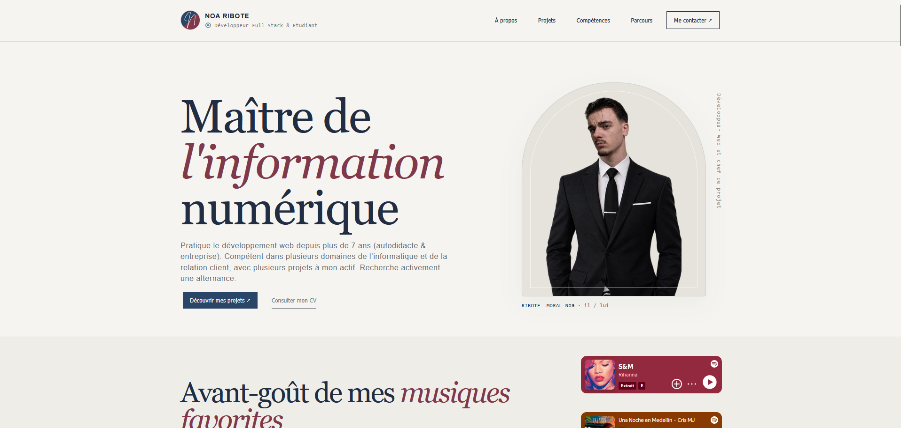

<div align="center">

# 🌐 Portfolio de Noa Ribote

**Portfolio personnel présentant mes projets, compétences, centres d’intérêt et parcours.**


[Voir le portfolio](https://www.noaribote.fr) · [Code source](https://github.com/noaribote/Portfolio) · [Me contacter](mailto:noaribotemoral@gmail.com)



</div>

---

## Sommaire

- [Pourquoi ce projet ?](#pourquoi-ce-projet-)
- [Fonctionnalités](#fonctionnalités)
- [Stack technique](#stack-technique)
- [Démarrage rapide](#démarrage-rapide)
- [Utilisation](#utilisation)
- [Structure du projet](#structure-du-projet)
- [Publication](#publication)
- [Licence](#licence)
- [Auteur](#auteur)

## Pourquoi ce projet ?

Ce portfolio me permet de présenter mon parcours, mes compétences et les projets
que j’ai réalisés dans un même espace, et de donner un aperçu de ma personnalité
et de mes centres d’intérêt.

## Fonctionnalités

- Présentation personnelle et accès au CV.
- Intégration de sélections musicales Spotify et carrousel de films et séries favoris.
- Galerie de projets avec liens vers leurs pages ou dépôts et affichage progressif.
- Présentation des compétences et du parcours professionnel et scolaire, avec filtres.
- Navigation fluide et menu adapté aux écrans mobiles.
- Coordonnées et liens vers les réseaux sociaux.
- Page de mentions légales.
- Animation 3D temporaire pour Halloween, affichée le 31 octobre.

## Stack technique

| Partie | Technologies |
| --- | --- |
| Pages et données | PHP, HTML |
| Styles | CSS |
| Interactions | JavaScript |
| Animation 3D d’Halloween | Three.js, FBXLoader et modèle FBX |
| Icônes | Font Awesome |
| Hébergement visé | Apache avec `mod_rewrite` et PHP |

Les données affichées dans les sections du portfolio sont regroupées dans
`model/data.php`. Les bibliothèques Three.js et Font Awesome sont chargées depuis
des CDN. Les lecteurs musicaux sont intégrés depuis Spotify.

## Démarrage rapide

### Prérequis

- PHP installé (version avec serveur web intégré) ou Apache configuré pour PHP.
- Un navigateur récent.
- Une connexion Internet pour les ressources intégrées depuis des services tiers.

### Lancer en local

À la racine du dépôt, lancez le serveur de développement PHP :

```sh
php -S localhost:8000
```

Ouvrez ensuite <http://localhost:8000> dans votre navigateur.

Le serveur intégré de PHP ne lit pas le fichier `.htaccess`. Pour tester les
règles de réécriture, les pages d’erreur et la redirection HTTPS du site, utilisez
Apache avec `mod_rewrite` et la prise en charge des fichiers `.htaccess` activés.

## Utilisation

La page d’accueil présente les différentes sections du portfolio. La navigation
permet d’accéder directement aux projets, aux compétences, au parcours et aux
coordonnées. Les mentions légales s’ouvrent depuis le pied de page ; elles sont
aussi accessibles en local à l’adresse
<http://localhost:8000/index.php?display=mentions>.

Les contenus des projets, compétences, expériences et formations sont définis
dans `model/data.php`. La présentation courte affichée sur la page d’accueil et
dans les métadonnées est dans `views/description.html`.

## Structure du projet

```text
.
├── index.php                          # Point d’entrée et assemblage de la page
├── model/
│   ├── data.php                       # Projets, compétences, parcours et autres données
│   └── githubAPI.php                  # Récupération d’une description depuis l’API GitHub
├── views/
│   ├── description.html               # Présentation courte
│   ├── mentions.html                  # Mentions légales
│   └── events/
│       └── halloween3DViewer.html     # Conteneur de l’animation d’Halloween
├── controller/
│   ├── main.js                        # Carrousel, filtres et interactions
│   ├── nav.js                         # Navigation et menu responsive
│   ├── responsive.js                  # Ajustements liés à la taille d’écran
│   └── events/
│       └── halloween3DViewer.js       # Scène Three.js et animation FBX
├── assets/
│   ├── css/                           # Styles du site
│   ├── images/                        # Portraits, logos, projets et médias
│   └── models/                        # Modèle 3D RunningZombie3D.fbx
├── public/                            # Fichiers publics, dont le CV s’il est présent
├── error/                             # Pages d’erreur HTTP personnalisées
├── .htaccess                          # Réécriture d’URL, HTTPS et erreurs Apache
├── robots.txt                         # Indication du sitemap aux robots
├── sitemap.xml                        # URL du site pour les moteurs de recherche
├── LICENSE                            # Conditions de consultation et redistribution
└── README.md
```

## Publication

Le site est conçu pour être servi par un hébergement compatible PHP. Le fichier
`.htaccess` fournit des règles propres à Apache : redirection vers HTTPS,
réécriture des URL et pages d’erreur personnalisées. Le sitemap déclare
`https://www.noaribote.fr/index.php` comme URL du site.

## Licence

Le fichier [LICENSE](LICENSE) autorise la lecture du code et la redistribution
de sa version originale non modifiée, sous réserve de conserver la licence et
d’attribuer clairement l’auteur avec un lien vers le dépôt. La modification,
l’adaptation et la redistribution de versions modifiées sont interdites sans
autorisation écrite préalable.

## Auteur

**RIBOTE--MORAL Noa** : [Portfolio](https://www.noaribote.fr) · [GitHub](https://github.com/noaribote) · [LinkedIn](https://www.linkedin.com/in/ribote-noa)
